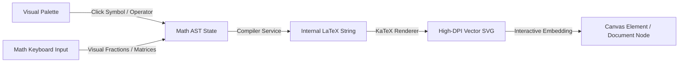
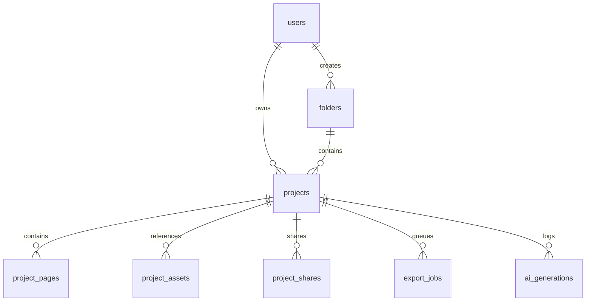
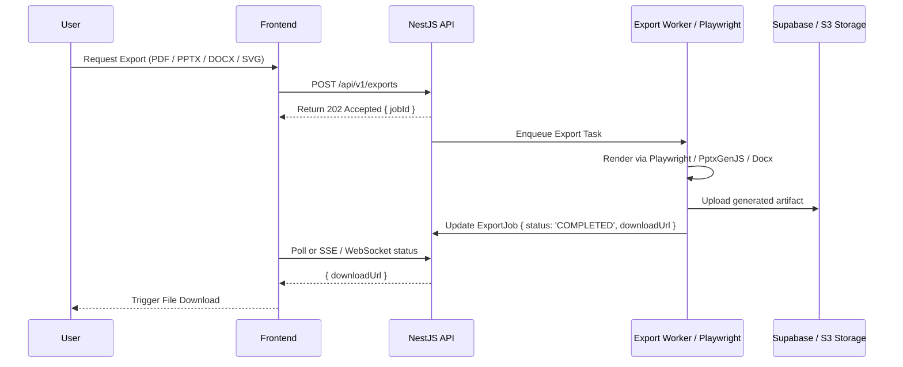

# VisualFlow Studio - System Architecture & Engineering Specification

## 1. Executive Overview

**VisualFlow Studio** is a unified, commercial-grade visual document, presentation, diagram, flowchart, and chart authoring platform. It blends the simplicity and aesthetics of Canva, the precision of Figma, the structured document flow of Notion/Google Docs, the node-graph capabilities of draw.io/Miro, and the presentation workflows of PowerPoint.

A foundational design requirement is that **all mathematical formulas and equations are visually constructed without users ever needing to write or understand LaTeX**, while internally using KaTeX/MathJax for vector-perfect mathematical typography.

---

## 2. Monorepo Structure

VisualFlow Studio is structured as a high-performance **pnpm monorepo**:

```
visualflow-studio/
├── apps/
│   ├── web/                     # Next.js 15+ App Router frontend
│   │   ├── app/
│   │   │   ├── (auth)/          # Login, Register, Callback
│   │   │   ├── (dashboard)/     # Projects, Templates, Starred, Folders, Settings
│   │   │   ├── studio/          # Unified Studio Route
│   │   │   │   ├── [id]/        # Document / Slide / Flowchart / Diagram / Chart / PDF
│   │   │   ├── page.tsx         # SaaS Landing page
│   │   │   └── api/             # Frontend proxy & SSR endpoints
│   │   ├── components/          # Design system & shared studio UI
│   │   ├── stores/              # Zustand stores (editor, history, selection, canvas)
│   │   └── hooks/               # Custom hooks (autosave, shortcuts, drag-and-drop)
│   ├── api/                     # NestJS Core Backend (Port 4000)
│   │   ├── src/
│   │   │   ├── auth/            # Supabase / JWT auth, RBAC, session guards
│   │   │   ├── users/           # User profiles, preferences, storage quota
│   │   │   ├── projects/        # CRUD, versioning, autosave snapshots
│   │   │   ├── documents/       # Document-specific services
│   │   │   ├── presentations/   # Slide deck operations & layouts
│   │   │   ├── diagrams/        # Flowchart/Diagram node graphs
│   │   │   ├── charts/          # ECharts dataset configs & transformations
│   │   │   ├── assets/          # Supabase storage & asset management
│   │   │   ├── templates/       # Prebuilt templates catalog
│   │   │   ├── exports/         # Export orchestrator (PDF, PPTX, DOCX, SVG, PNG)
│   │   │   ├── ai/              # Provider-agnostic AI assistant (Structured JSON)
│   │   │   ├── collaboration/   # WebSockets / Presence / Cursor tracking
│   │   │   └── database/        # Prisma module & client
│   │   └── prisma/              # Prisma schema & migrations
│   └── worker/                  # Async job processor for heavy exports & AI jobs
├── packages/
│   ├── shared-types/            # Canonical TypeScript types & interfaces
│   ├── document-schema/         # Universal Project JSON Schema & Zod validators
│   ├── editor-core/             # Undo/redo stack, transform math, snap-to-grid, selection
│   ├── rendering/               # Unified renderers (Konva, React Flow, ECharts, KaTeX)
│   └── ui/                      # Shared Tailwind & shadcn UI primitives
├── infrastructure/              # Docker, Supabase, Postgres configs
└── docs/                        # Architecture, Roadmap, Progress, API Specs
```

---

## 3. Universal Project Schema Architecture

Every project is saved as a structured, versioned, portable JSON object. Projects are never stored solely as rasterized images or exported PDFs.

### 3.1 Canonical JSON Schema Structure

```typescript
export type ProjectType = 'document' | 'slide' | 'flowchart' | 'diagram' | 'chart' | 'pdf';

export interface UniversalProject {
  id: string;
  version: number;               // Schema versioning (v1, v2, etc.)
  type: ProjectType;
  title: string;
  description?: string;
  folderId?: string | null;
  tags: string[];
  thumbnailUrl?: string;
  isStarred: boolean;
  createdAt: string;
  updatedAt: string;
  settings: ProjectSettings;
  pages: UniversalPage[];
  assets: ProjectAssetReference[];
  metadata: Record<string, unknown>;
}

export interface UniversalPage {
  id: string;
  order: number;
  name: string;
  width: number;
  height: number;
  unit: 'px' | 'mm' | 'in';
  background: PageBackground;
  elements: CanvasElement[];
  nodes?: FlowNode[];            // For React Flow studios
  edges?: FlowEdge[];            // For React Flow studios
  documentContent?: RichDocContent; // For Document Studio (Tiptap JSON)
  chartConfig?: EChartProjectConfig; // For Chart Studio
  slideSettings?: SlidePageSettings; // Transitions, speaker notes
}
```

### 3.2 Visual Canvas Elements (`CanvasElement`)

```typescript
export type ElementType =
  | 'text'
  | 'shape'
  | 'arrow'
  | 'connector'
  | 'image'
  | 'icon'
  | 'table'
  | 'equation'
  | 'chart'
  | 'group'
  | 'diagram-node';

export interface BaseElement {
  id: string;
  type: ElementType;
  name: string;
  x: number;
  y: number;
  width: number;
  height: number;
  rotation: number;
  opacity: number;
  zIndex: number;
  isLocked: boolean;
  isVisible: boolean;
  groupId?: string;
  style: ElementStyle;
}
```

---

## 4. Studio Boundaries & Dedicated Rendering Engines

To ensure rock-solid stability and zero library collision, rendering engines have strictly defined roles:

| Studio | Core Engine | Complementary Libraries | Role & Scope |
|---|---|---|---|
| **Universal Canvas / Slide Studio** | **Konva.js / React-Konva** | Fabric.js (advanced vector paths) | Freeform visual layout, shapes, text frames, slide layers, alignment guides, transforms, rotation, snap-to-grid |
| **Flowchart & Diagram Studio** | **React Flow** | Dagre, ELK.js, Mermaid parser | Node-based graphs, smart orthogonal/bezier routing, port connectors, auto-layout algorithms |
| **Document Studio** | **Tiptap / ProseMirror** | KaTeX, Canvas plugins | Paged A4/Letter rich-text flow, continuous margins, real headers/footers, footnotes, math blocks |
| **Chart Studio** | **Apache ECharts** | Handsontable/Ag-Grid, PapaParse | High-performance interactive charts, scatter, candlestick, radar, heatmaps, live tabular editor |
| **Math / Equation Engine** | **Visual Equation Builder** | KaTeX (primary), MathJax (fallback) | Visual mathematical palette producing vector SVG & KaTeX rendering; zero LaTeX exposure to users |

---

## 5. Visual Equation Engine (Zero-LaTeX Architecture)

### 5.1 The Interaction Pipeline



1. **Visual UI**: The user accesses categorized tabs: *Arithmetic, Fractions & Roots, Calculus & Integrals, Linear Algebra & Matrices, Greek Letters, Physics & Chemistry*.
2. **Visual AST**: The component tree manages an abstract syntax tree of operations (e.g. `FractionNode(numerator, denominator)`, `IntegralNode(lower, upper, integrand)`).
3. **Internal Synthesis**: The engine compiles the AST to a sanitized LaTeX string (e.g. `\frac{a^2 + b^2}{\sqrt{c}}`).
4. **Instant KaTeX Preview**: Rendered directly in real-time as an SVG element.
5. **Storage**: The element stores `{ ast: MathAST, renderedSvg: string, mathMl?: string }` so it remains fully editable visually at any time.

---

## 6. Backend & Database Architecture

### 6.1 Database Entity Relationship



### 6.2 Key Database Tables (PostgreSQL with Prisma)

- **`users` & `profiles`**: Identity, display name, avatar, tier, preferences.
- **`folders`**: Hierarchical organization for user workspaces.
- **`projects`**: Top-level entity (`type`, `title`, `thumbnail_url`, `is_starred`, `settings`).
- **`project_pages`**: Page-level content JSON (width, height, background, elements, nodes, edges).
- **`project_assets`**: S3/Supabase stored images, SVGs, custom icons.
- **`templates`**: Curated system and community templates categorized by studio.
- **`export_jobs`**: Asynchronous export tracking (`status`, `format`, `progress`, `download_url`).
- **`ai_generations`**: Auditable prompts, generated structured JSON, and model parameters.

---

## 7. Export Pipeline Architecture

High-quality export is critical for commercial document tools:



- **PDF Export**: Headless Chromium via Playwright executing print media CSS, exact `@page` rules, high-resolution vector KaTeX equations, and crisp fonts.
- **PPTX Export**: PptxGenJS translating canvas shapes, text blocks, colors, and layout positions into native Microsoft PowerPoint slides.
- **DOCX Export**: Structured OpenXML document generation preserving headings, tables, embedded diagrams, and styled paragraphs.
- **SVG / PNG Export**: Direct canvas vector serialization and multi-multiplier (1x, 2x, 4x DPI) rasterization with transparency options.

---

## 8. Provider-Agnostic AI Assistant Architecture

The AI module uses a strictly typed **Structured Output Protocol**:
1. It supports pluggable providers: OpenAI, Google Gemini, Anthropic, or Local Ollama via standard interfaces.
2. AI responses are strictly validated against **Zod schemas** before reaching the client.
3. The editor previews the generated structured canvas/page elements with an "Accept / Modify / Reject" diff preview.
4. Generates zero arbitrary raw HTML or arbitrary scripts—only valid `UniversalProject` or `CanvasElement` trees.

---

## 9. Performance & Security Standard

- **Rendering Performance**: Virtualized layers, debounced canvas redraws (requestAnimationFrame), spatial indexing for element bounding boxes.
- **State Management**: Zustand split slices (canvas slice, selection slice, history slice, UI slice) to isolate re-renders.
- **Autosave Engine**: Smart debounced persistence (1.5-second inactivity timer with dirty-flag checking) to avoid hammering the API.
- **Security**: JWT & Supabase session validation, project ownership verification on every mutation, sanitize all SVG/HTML inputs, CSP headers, rate-limiting on exports and AI endpoints.
